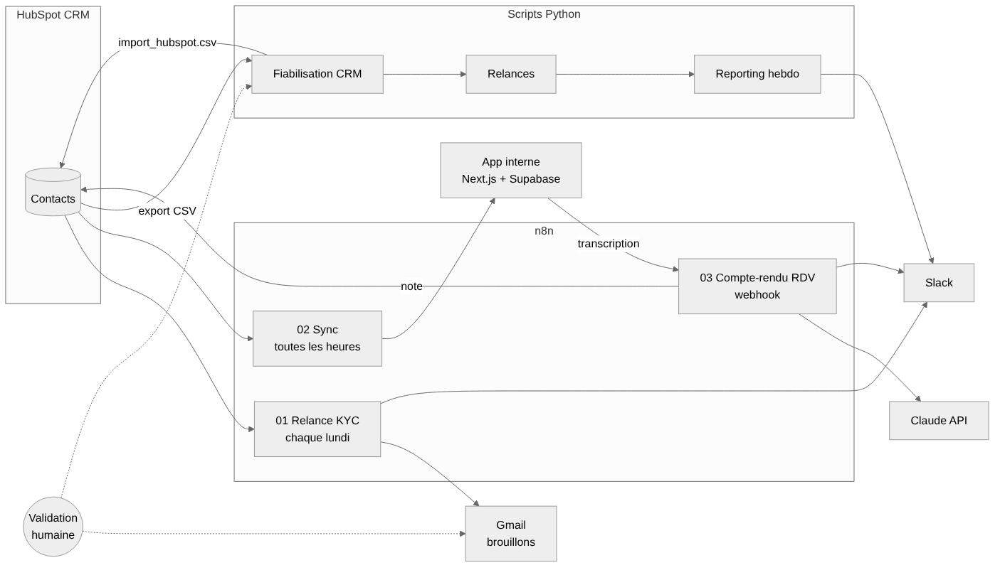

# ⚙️ cgp-automatisations

**Automatisations métier d'un cabinet de conseil en gestion de patrimoine (fictif)** : fiabilisation du CRM HubSpot, relances clients, reporting hebdomadaire et **workflows n8n**. Le dépôt est configuré pour être piloté avec **Claude Code**.

C'est le complément « ops » de l'app interne [cgp-app-interne](https://github.com/Teede-N/cgp-app-interne).



## Ce qui est automatisé

| Process | Automatisation | Ce qui reste humain |
|---|---|---|
| **Fiabilisation du CRM** | Normalisation (casse, espaces, e-mails, téléphones), contrôles de complétude, KYC, **détection des doublons** et fichier de réimport HubSpot avec l'ancienne valeur de chaque champ | Fusionner les doublons proposés |
| **Relances clients** | Repérage des KYC à renouveler et des clients sans contact depuis 90 jours, puis **brouillons d'e-mails personnalisés** | Relire et envoyer |
| **Reporting** | Synthèse hebdomadaire en Markdown et **message Slack** (Block Kit) | Commenter en réunion d'équipe |
| **Comptes-rendus de RDV** | Workflow n8n : webhook de l'app, puis Claude, puis note HubSpot, puis Slack | Relire le compte-rendu |
| **Synchronisation** | Workflow n8n : HubSpot vers Supabase toutes les heures | — |

**Résultat sur l'export d'exemple** (64 contacts volontairement « sales ») :
- **102 corrections automatiques** ;
- les **4 doublons** cachés dans l'export retrouvés, sans faux positif ;
- la part de fiches complètes et conformes passe de **0 % à 30 %** ;
- **20 brouillons de relance** prêts à relire ;
- le reste est listé pour les conseillers dans le [rapport qualité](sorties/rapport_qualite.md).

## Workflows n8n (importables)

| Fichier | Déclencheur | Étapes |
|---|---|---|
| [`01_relance_kyc_hebdo.json`](n8n/01_relance_kyc_hebdo.json) | Chaque lundi à 8 h | HubSpot → filtre KYC (code) → brouillon Gmail → récapitulatif Slack |
| [`02_sync_hubspot_supabase.json`](n8n/02_sync_hubspot_supabase.json) | Toutes les heures | HubSpot → mapping vers le schéma de l'app (code) → upsert Supabase |
| [`03_compte_rendu_vers_hubspot.json`](n8n/03_compte_rendu_vers_hubspot.json) | Webhook | Claude (HTTP) → note HubSpot → Slack |

Les workflows sont importés **désactivés**, avec des identifiants de connexion à remplacer. Les tests vérifient qu'ils sont bien formés : aucun nœud orphelin, aucun secret dans le dépôt.

## Piloter le dépôt avec Claude Code

- [`CLAUDE.md`](CLAUDE.md) : contexte, règles non négociables (pas d'envoi ni de fusion automatique, pas de secret) et conventions.
- Commandes personnalisées dans [`.claude/commands/`](.claude/commands/) :
  - `/fiabiliser-crm` : lance la fiabilisation et résume les actions ;
  - `/rapport-hebdo` : prépare le reporting sans le publier ;
  - `/nouvelle-automatisation` : fiche process d'abord, puis le code, les tests et un workflow n8n si besoin.

## Process documentés

- [Relance de mise à jour KYC](docs/process/relance_kyc.md)
- [Fiabilisation mensuelle du CRM](docs/process/fiabilisation_crm.md)

## Lancer le projet

```bash
python data/generer_export.py                      # export HubSpot fictif
PYTHONPATH=src python -m automatisations.reporting # chaîne complète → dossier sorties/
pytest -q                                          # 14 tests (dont la validation des workflows n8n)
```

## Stack

Python (bibliothèque standard) · n8n · API HubSpot · Supabase · Gmail · Slack (Block Kit) · API Claude · Claude Code · pytest · GitHub Actions

---
Projet réalisé par **Teede Augustin NOUDAMADJO**, étudiant en Master 2 Big Data & IA. Données entièrement fictives. [LinkedIn](https://www.linkedin.com/in/teede-noudamadjo)
